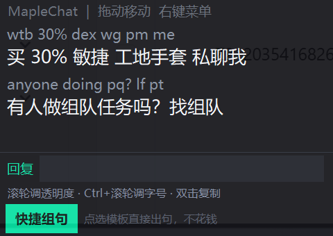

---
AIGC:
    Label: "1"
    ContentProducer: 001191440300708461136T1XGW3
    ProduceID: 56137a95a2d193780765819d098cfe37_c1abe3eee31811f189bc525400248c00
    ReservedCode1: XdOa29qeKox6POqHLcPT6t2yizXPCNJJSKXE6S9SqOQsGthJJQPppNBcgtVZMnjW49Ipe9SEJVzN8fvOrR+mgfl6ZCY1YDpSfrLeLZ3+E6XEn3wk/s08qyVZz4W4XvhpF19g9iyiZcjKxAfRjLUkEsrsn01spoXS+IGurqRsltUAbfkDZyClN+3CAvY=
    ContentPropagator: 001191440300708461136T1XGW3
    PropagateID: 56137a95a2d193780765819d098cfe37_c1abe3eee31811f189bc525400248c00
    ReservedCode2: XdOa29qeKox6POqHLcPT6t2yizXPCNJJSKXE6S9SqOQsGthJJQPppNBcgtVZMnjW49Ipe9SEJVzN8fvOrR+mgfl6ZCY1YDpSfrLeLZ3+E6XEn3wk/s08qyVZz4W4XvhpF19g9iyiZcjKxAfRjLUkEsrsn01spoXS+IGurqRsltUAbfkDZyClN+3CAvY=
---

# MapleChat

冒险岛国际服怀旧聊天 OCR 翻译工具 —— 截屏识别聊天栏 → 云端 LLM 翻译 → 悬浮窗实时显示，同时提供反向翻译和中英双向快捷组句。

桌面版为 Python + Tkinter 单进程；网页版为纯静态前端（PP-OCRv4 WASM + 浏览器直连 LLM），零安装、零后端。都不注入游戏、不读取游戏内存。

[](https://wokkkkka.github.io/MapleChat/) [](https://github.com/WOKKKKKA/MapleChat/releases) [](https://github.com/WOKKKKKA/MapleChat/releases/tag/v0.6-mac)


---

## 功能特性

| 模块 | 说明 |
| --- | --- |
| **实时聊天翻译** | 框选聊天区域后按固定间隔截屏 + RapidOCR 识别 + DeepSeek 翻译，译文推到始终置顶的悬浮窗 |
| **悬浮窗** | 无边框半透明，可拖动/滚轮调透明度/`Ctrl+滚轮` 调字号，双击复制全文 |
| **打字回复（反向翻译）** | 输入中文 → 回车直译成英文并自动复制，直接在游戏聊天框粘贴发送 |
| **快捷组句** | 本地零成本组句器，复刻 mscw generator 的 8 大场景 / 51 个动作，不消耗任何 API 额度 |
| **术语库** | 391 个词条 / 11 个分组 / 740 个别名，OCR 后与翻译前双向纠错，避免技能名、地图名、道具名被乱翻 |
| **深色卡片式 UI** | 分区折叠布局，窗口与悬浮窗都做了屏幕边界自适应 |



---

## 快速开始

### 方式零：网页版（免安装，打开就能用）

在线地址：**https://wokkkkka.github.io/MapleChat/**

| 能力 | 网页版 | 说明 |
| --- | --- | --- |
| 实时聊天翻译 | ✅ | 共享游戏窗口 → 框选聊天栏 → 自动 OCR + 翻译 |
| 置顶悬浮窗 | ✅ | Document Picture-in-Picture，Chrome / Edge 116+ 原生置顶 |
| 反向翻译 | ✅ | 中文 → 英文，一键复制 |
| 快捷组句 | ✅ | 8 场景 / 51 动作，本地生成，零 API 消耗 |
| 术语库 | ✅ | 与桌面版同一份 `terms.json`，本地纠错 |
| 截图备用入口 | ✅ | 不想共享整屏时，`Win+Shift+S` 截图后直接 `Ctrl+V` 粘贴到页面 |

用法：① 点「选择画面」共享游戏窗口 → ② 在预览里拖框选中聊天栏 → ③「开始翻译」→ ④「置顶悬浮窗」把译文窗拖到游戏上。浏览器不允许网页默认截屏，所以第一次必须手动授权一次共享。

注意事项：

- 纯静态托管、**没有后端**。API Key 只存在你自己浏览器的 `localStorage`，请求由浏览器直连 `api.deepseek.com`，不经过任何第三方服务器
- 首次打开需下载约 16MB OCR 模型，之后走浏览器缓存
- GitHub Pages 不返回 COOP/COEP 响应头，ONNX Runtime 只能单线程 WASM，OCR 单帧约 1.1s（桌面版约 0.5s）；自动翻译间隔默认 900ms
- 网页版源码在 `docs/`，开发自检页在 `dev/selftest.html`

### 方式一：直接运行 EXE（推荐）

1. 下载仓库中的 `MapleChat.exe` 与同目录的 `_internal` 文件夹，**两者必须放在同一目录**
2. 双击 `启动.vbs`（无黑框启动）或直接双击 `MapleChat.exe`
3. 首次运行在「翻译设置」里填入自己的 DeepSeek API Key，点「重新框选」划定游戏聊天栏区域
4. 按 `Ctrl+Alt+S` 开始翻译

> `config.json` 存有 API Key 与屏幕坐标，**不会**提交到本仓库；首次运行会自动生成，也可以从 `config.example.json` 复制一份。

### 方式二：从源码运行

环境要求：Windows 10/11 + Python 3.11

```bat
python -m venv C:\MapleChat_rt
C:\MapleChat_rt\Scripts\python.exe -m pip install -r requirements.txt
C:\MapleChat_rt\Scripts\python.exe main.py
```

也可以直接双击 `安装环境.bat` 自动建环境装依赖，再双击 `启动.bat`（带控制台，方便看日志）或 `启动（无黑框）.vbs`。

> 虚拟环境刻意放在 `C:\MapleChat_rt` 这类短路径下：`onnxruntime` / `opencv` 的默认包路径在项目目录内会触发 Windows 260 字符长路径限制，装不上。

自检（不启动界面，只验证 OCR / 截屏 / 术语库 / 剪贴板 / 组句链路）：

```bat
MapleChat.exe --selftest
```

### 方式三：macOS（Apple Silicon）

下载 [MapleChat-mac-arm64.dmg](https://github.com/WOKKKKKA/MapleChat/releases/download/v0.6-mac/MapleChat-mac-arm64.dmg)（约 94 MB），双击挂载后把 `MapleChat.app` 拖入「应用程序」。

macOS 版当前为 **Beta**，要求 Apple Silicon（M1 及以上）+ macOS Sequoia 15.0 或更高版本。

首次运行前必须做三件事，否则会出现「截图全黑 / 热键无反应」：

1. 解除隔离：`xattr -dr com.apple.quarantine /Applications/MapleChat.app`
2. 系统设置 → 隐私与安全性 → **屏幕录制**，勾选 MapleChat（不授权则截屏全黑）
3. 系统设置 → 隐私与安全性 → **辅助功能**，勾选 MapleChat（不授权则全局热键失效）

macOS 全局热键为 `Ctrl+Option+S/D/Q/H/M`，配置文件位于 `~/Library/Application Support/MapleChat/config.json`（`.app` 为只读包，配置不写在包内）。

从源码构建 / 运行（macOS）：

```bash
python3 -m venv ~/MapleChat_rt
~/MapleChat_rt/bin/python -m pip install -r requirements-mac.txt
~/MapleChat_rt/bin/python main.py
```

打包 DMG：

```bash
bash build_mac.sh     # 产物：dist/MapleChat-mac-arm64.dmg
```

详细说明见 [使用说明-mac.md](使用说明-mac.md)。

---

## 全局热键

下表为 Windows 版；macOS 版把 `Alt` 换成 `Option`，即 `Ctrl+Option+S/D/Q/H/M`。

| 热键 | 功能 |
| --- | --- |
| `Ctrl+Alt+S` | 开始 / 停止实时翻译 |
| `Ctrl+Alt+D` | 快译剪贴板内容（备选 `Ctrl+Alt+G`） |
| `Ctrl+Alt+Q` | 打开快捷组句 |
| `Ctrl+Alt+H` | 显示 / 隐藏悬浮窗 |
| `Ctrl+Alt+M` | 显示 / 隐藏主窗口 |

界面内快捷键：

- 打字回复框：`回车` 直译并复制，`Shift+回车` 换行
- 悬浮窗：双击复制全文，滚轮调透明度，`Ctrl+滚轮` 调字号

---

## 配置说明

`config.json`（首次运行自动生成）

| 字段 | 说明 |
| --- | --- |
| `api_key` | DeepSeek API Key，为空时无法翻译 |
| `api_base` | 接口地址，默认 `https://api.deepseek.com` |
| `model` | 模型名，默认 `deepseek-chat` |
| `region` | 聊天栏截屏区域 `[x, y, w, h]`，由「重新框选」写入 |
| `target_lang` | 目标语言，默认简体中文 |
| `interval_ms` | 截屏识别间隔，默认 700ms |
| `scale` / `binarize` | OCR 放大倍数与二值化，小字号聊天框建议开启 |
| `only_when_foreground` | 仅当游戏窗口在前台时才截屏，省额度 |
| `window_keyword` | 前台窗口标题关键字，留空则不限 |
| `terms_enabled` | 是否启用术语库纠错 |
| `overlay` | 悬浮窗位置、尺寸、透明度、字号、最大行数 |

---

## 术语库

`terms.json` 收录 391 个词条、11 个分组、740 个别名，数据整理自 [mscw-guidebook.com](https://mscw-guidebook.com)，版本标记 `2026-11-17`。结构为分组 → 中文名 → 英文别名列表，可直接编辑扩充，OCR 命中别名时会优先按术语翻译，避免专有名词被模型自由发挥。

---

## 成本

只翻译真正发生变化的聊天行，走 `deepseek-chat`，单条消息约 **0.0002 元**。日常挂机按千条/天估算，一天不到两毛钱。快捷组句完全离线，不产生费用。

---

## 合规说明

- 只通过系统截屏读取**屏幕上已渲染的像素**，不注入进程、不读写游戏内存、不修改客户端文件、不拦截网络封包
- 对外唯一输出是系统剪贴板与一个独立悬浮窗，游戏客户端感知不到本工具存在
- 严格的 OCR 截屏方案在原理上等同于「用眼睛看 + 手动打字」，但仍请自行评估所在服务器的用户协议风险

---

## 已知限制

- 游戏必须使用**窗口化 / 无边框窗口**模式：独占全屏下系统截屏只能拿到纯黑画面
- OCR 对小字号、低对比度、花体字的识别率有限，建议把聊天栏字号调大、开启 `binarize`
- 悬浮窗与游戏同屏显示需要游戏处于窗口化模式

---

## 目录结构

```
MapleChat_v4/
├─ MapleChat.exe          打包后的主程序（Windows）
├─ _internal/             打包运行时（Python 解释器 + 模型 + 依赖）
├─ main.py                主程序源码（OCR / 翻译 / 悬浮窗 / UI）
├─ plat.py                平台抽象层（Win32 / macOS 差异全部收敛于此）
├─ chatgen.py             快捷组句数据与生成逻辑
├─ terms.json             术语库
├─ config.example.json    配置模板
├─ requirements.txt       源码运行依赖（Windows）
├─ requirements-mac.txt   源码运行依赖（macOS）
├─ build_mac.sh           macOS 打包脚本（产出 arm64 DMG）
├─ 使用说明.md             详细使用文档（Windows）
├─ 使用说明-mac.md         详细使用文档（macOS）
├─ 启动.vbs                无黑框启动 EXE
├─ 启动.bat / 调试启动.bat  源码启动（带控制台便于排错）
├─ 安装环境.bat            一键创建运行环境
│
├─ docs/                  ★ 网页版（GitHub Pages 源目录，纯静态）
│  ├─ index.html           主界面
│  ├─ css/style.css        深色卡片式 UI
│  ├─ js/app.js            捕获 / 去重 / 翻译 / 悬浮窗主控
│  ├─ js/ocr.js            PP-OCRv4 ONNX Runtime WASM 推理封装
│  ├─ js/chatgen.js        快捷组句前端实现
│  ├─ data/terms.json      术语库（与桌面版同一份数据）
│  ├─ data/chatgen.json    组句数据（由 chatgen.py 导出）
│  ├─ models/              ch_PP-OCRv4 det / rec / 字符集
│  └─ vendor/              onnxruntime-web
│
└─ dev/                   开发自检页与测试图（不参与线上）
```

---

## License

